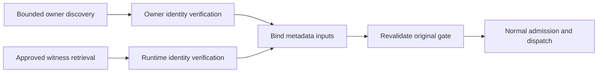

# Autonomous prerequisite recovery

## Scope and incident

An autonomous supervisor must turn a missing prerequisite into owned work. It must not repeatedly report the same blocker, repeat an exhausted lookup, or treat an unauthenticated filename as a usable capability.

The incident exposed four connected failures: an owner pointer was absent from retained context; a historical plan and runtime bootstrap were mistaken for possible metadata-preparer provenance; the approved interpreter/vendor witness was unavailable; and selected finite dependency work repeatedly required per-file or Coordinator acknowledgments. Context loss and cumulative read budgets then made recovery harder.

This change's first slice is deterministic typed prerequisite plans in the existing recovery packet, with first-refusal notification through the existing lane. Automatic task admission, resolver/verifier execution, runtime enrollment and service deployment are later stages. A plan is not a completed recovery or permission to execute it. No numeric run, model result, legal interpretation, or corpus qualification is established here.

## Reuse the existing control plane

Use these owners; do not introduce another daemon, queue, registry or artifact authority:

- `rescue/lane_resume.py::gate_result` observes the gate and emits the existing packet through `GateRecovery.packet`.
- `rescue/gate_recovery.py` owns durable refusal/backoff state. Its packet is the narrow integration point for typed recovery proposals; prerequisite facts must participate in the evidence fingerprint.
- `task_sources/dependency_block_resolution.py` can supply pure deterministic planning. Extending `resolution_obligations` alone is insufficient: no production caller was found in the inspected current accelerator source/scripts or root scripts.
- `IntentRepository` already owns task creation, dependency edges, evidence nodes, validation results, revisions and status CAS. Keep durable work and progress there.
- `execution_packet_admission.py` already admits the metadata purposes `control_metadata_analysis` and `metadata_validation` using current signed contracts and independently recorded validation.
- `admit_gate_repair_task` is the existing board-text repair admission transform. It preserves parent status and acceptance, validates a concrete command and behavioral validator, adds an upstream dependency, and refuses cycles and recapture-only repairs. It is an extension point, not an already wired automatic dispatcher.

Registered preparer views must come from existing owner/profile evidence and metadata indexes. Raw bodies and descriptors belong in the existing content-addressed artifact store. The index is a locator projection; the verified artifact and its authority chain remain the evidence. A historical plan, runtime runner, source pin, or arbitrary successful command cannot substitute for a registered preparer.

## One selected work-unit contract

The primary grant owner for the incident is `01a0f851`; Coordinator/observer `01a133b9` is not a replacement grant authority. Delegation and grants must identify their actual authority rather than treating every chat acknowledgment as a new execution grant.

A selected finite unit must bind:

1. Objective/task identity and revision, requirement identity, source generation and permitted operation kinds.
2. Exact input descriptors, allowed roots and named dependency edges, output schemas, validators and expected authority boundaries.
3. Whole-unit limits for new bytes, files, tokens, processes, CPU/memory/storage, deadline and attempts, including already consumed amounts.
4. The owner, lease/fence, cancellation conditions, operator holds, and whether independent metadata work is permitted while scientific execution is held.
5. A durable progress cursor and the required witnesses for each transition.

Within that contract, the owner follows already permitted AST dependency edges and completes the selected unit without obtaining a new per-file Coordinator acknowledgment. An actual edge outside the declared closure produces a bounded scope-expansion proposal or an exact external wait; it does not authorize an unrestricted recursive scan.

The incident's selected 96-file Source unit must not be restarted, widened, split to evade caps, or silently repinned by this design. Its selected scope, R2 Git identity, state, receipts and authorization epochs remain unchanged until its owner selects a transition.

## Recover durable pointers before repeating I/O

Persist descriptors and canonical raw metadata independently of the model context. Every handoff carries resolvable artifact references and the work-unit identifier, not an undefined directory alias or a prose-only filename.

Before continuing, the owner checks the contract, ledger and cached artifact completeness. A cache entry has exact bytes, SHA-256, schema, provenance, source/review generation and validation status. Missing chat context can be repaired from this durable evidence without spending another source read. An index hit is still verified against its immutable descriptor.

Store nanosecond integers losslessly: retain canonical raw JSON or a schema-defined exact integer/decimal-string representation. Do not round full9 fields through JavaScript `Number`. Reject truncated JSON, duplicate keys, ambiguous descriptors and incompatible schema conversions. A partial cache entry is explicitly incomplete and can never stand for a complete artifact.

## Cumulative budgets survive delegation and restart

Extend the existing resource/artifact accounting owners with a work-unit journal that reserves bounded I/O before an operation and records its actual charge and result afterward. This end-to-end journal is a design requirement, not functionality established by the first packet-planning slice. Failed, partial and refused reads remain charged as specified by the contract; interrupted reservations remain outstanding until the existing custody/reconciliation path resolves them.

Subagents use the same unit and ledger. Restart, context compaction, retry, a new trace ID, or a different worker never resets consumed bytes, attempts, retained reservations or deadlines. Retain an absolute expiry plus the live monotonic deadline; recovery may shorten the remaining interval but cannot renew an exhausted clock.

A bounded named-artifact read is a distinct explicitly selected unit. Its unused balance does not authorize another file, recursive reference following, global lookup, asset inspection or execution. Unknown earlier totals remain unknown rather than being certified by a new local counter.

## Typed blockers and autonomous next actions

| Blocker | Bounded recovery action | Evidence needed to leave the state |
| --- | --- | --- |
| Lost artifact pointer | Resolve the exact known descriptor through the existing metadata index/artifact store | Same immutable bytes and authority lineage; no new source read if cached |
| Registered preparer unresolved | Query the declared capability/owner evidence within the unit | Exact reviewed preparer path/CID, SHA, CLI/schema, owner and current scope |
| No preparer exists within the bounded evidence | Create an engineering implementation/registration prerequisite under the existing owner | Tested implementation, independent review and normal registration; never an invented collector |
| Runtime witness missing | Retrieve an existing approved witness or schedule its approved verifier | Exact interpreter/vendor identities, versions, platform and environment/profile binding |
| Serialization incomplete or lossy | Rehydrate canonical raw bytes and validate the declared codec | Exact descriptor, complete schema and lossless full9 values |
| Stale or conflicting evidence | Revalidate the affected generation through its owner | Current independent verification or an explicit conflict disposition |
| Approval, budget or scope unavailable | Produce one precise external requirement and continue other independent work | A real new grant, permitted scope, available resource or reviewed input |

Keep missing-pointer, not-found-within-scope, stale-evidence, approval-required and budget-exhausted outcomes distinct. A scoped `MISSING_OWNER_POINTER` is not a claim of global absence. Negative results are cached against the requirement and source generation; another identical lookup is not progress.

Unknown typed requirements remain explicit external requirements; they must never disappear because the planner lacks a handler. A malformed or oversized declaration produces a bounded rejection and its digest, without copying rejected command text into the recovery packet. The first slice suppresses partial proposals whenever an external requirement remains. Independently selected units can still progress through their own contracts.

Ordinary diagnostic volume is not typed prerequisite input. Oversized untyped gap lists are skipped, and the 256-artifact bound counts actual typed prerequisite records rather than unrelated legacy reports. Explicit declarations and typed diagnostics retain their existing raw-input and requirement limits. Ordinary first refusals retain the legacy behavior even with 65 gaps or 257 artifacts; unrelated large reports do not invalidate an otherwise valid typed declaration.

Strict UTF-8 remains required for declared input. If rejected Python text contains unpaired Unicode surrogates, compute only its diagnostic identity with UTF-8 `surrogatepass`; retain the constant invalid-declaration marker in evidence and packets. This lossless identity describes rejected Python text, not an admitted UTF-8 artifact or execution input. Ordinary UTF-8 diagnostic digests and valid proposal IDs remain unchanged.

A file-identity check is not a runtime ABI check. Reading an approved environment manifest may fit a metadata contract; importing Torch, invoking a compiler or loading a native vendor component still requires that operation's existing resource and execution policy. No metadata label grants model execution, paid inference, training, scientific completion or accepted legal meaning.

## Dependency graph and admission

Arrows represent prerequisite completion. The scientific parent depends on the verified metadata result; discovery does not depend on the blocked scientific parent. Goal membership is separate from task dependency. This prevents the common cycle where every new recovery task is blocked by the very operation it must unblock.

Use deterministic operation/task IDs derived from the parent revision, typed requirement, relevant evidence generation and approved recovery kind. Upsert and link with the existing revision/fence CAS and idempotency rules. Concurrent workers converge on one owned prerequisite rather than creating duplicate audits or controllers.

The first slice supplies stable proposal IDs from the parent task and typed requirement, including an expected digest when declared. These IDs are not execution or receipt identities. Admission must additionally bind the current parent revision, source generation, policy and complete work-unit contract; an old proposal ID cannot authenticate a new witness.

The blocked-successor helper's current requirement for blocked status and nonempty dependencies is not a runnable metadata admission path by itself. Recovery plans become eligible work only through the existing fenced task/packet admission boundary. Verification or discovery must never directly set the scientific parent ready, remove a hold, fabricate a signature, or mark the goal complete.

After the prerequisite is independently verified, re-run the original gate against current identities and its unchanged budget. Success of the discovery task alone is not success of the original task. Superseding evidence invalidates downstream bindings through the existing dependency machinery.

## Scheduling, latches and observability

Run independent owner discovery and witness retrieval in parallel when their scopes and resources permit it. Use existing exclusive keys for Source/Git or other shared mutation. A genuine live attempt stays with its owner for polling and terminal cleanup; an observation timeout is not permission to restart it.

Schedule bounded metadata and engineering prerequisites fairly alongside publication work. A named higher-priority task can defer another task, but indefinite priority chains must surface the responsible dependency, age and next eligible action. A scientific hold may coexist with independently authorized metadata work; a global hold remains global.

The existing watchdog and scheduler should apply this decision table under their current revision/fence checks, using bounded scans and the configured grace periods. This is APR-05/07 integration work; it does not require another monitoring daemon.

| Observed state | Autonomous action |
| --- | --- |
| Global hold | Dispatch no new work; retain the exact release requirement |
| Scientific hold with independently authorized metadata work | Claim eligible metadata work through normal admission |
| Admitted runnable work, no owned attempt, grace period elapsed | Perform one idempotent scheduler claim and dispatch |
| No runnable work, incomplete prerequisites | Emit and admit bounded recovery work through the existing owners |
| Owned work quiet before its deadline | Preserve ownership and monitor; quiet computation is not a stall |
| Deadline breach, orphan or expired lease | Reconcile ownership and process custody before retry eligibility |

Bind an owned process to its handle, birth identity, fence, deadline and verified progress cursor. An `in_progress` label or PID alone proves neither liveness nor ownership. On a real timeout or orphan, use the existing cancellation/custody path and genuine wait/reaping before replacing the attempt. Observation timeout, delayed chat or missing log lines cannot authorize a duplicate process. A failing registered implementation may produce a deduplicated engineering repair task with tests and normal review/adoption; the watchdog must not repeatedly invoke the same failed operation.

Persist a no-progress recovery counter under the incident/work-unit identity. Repeated recovery with no verified new fact opens a circuit breaker: create one owned engineering prerequisite or report one precise external requirement, then continue other independent work. Identical receipts, clock ticks, worker changes and restarts do not clear the circuit or reset spent budgets. Valid new evidence or an explicitly selected scope/generation change may change eligibility through normal admission.

The current board-stall signature based on hold state and blocked aliases is insufficient to notice changed prerequisite evidence. Track a stable prerequisite-frontier digest containing relevant task revisions, requirements and verified evidence generations. Do not use wall-clock ticks, new run IDs or refreshed log timestamps as progress or as a repair-budget reset.

Prerequisite diagnostics belong in the gate-evidence fingerprint, while the existing Source-refusal budget remains bound to code and acceptance contracts. Finding another pointer, changing a diagnostic digest, or sanitizing a declaration cannot reset that budget. The first-refusal hook exposes a typed missing prerequisite immediately through the existing recovery-needed result and packet. It preserves the existing repeated-refusal thresholds for dependency probes, deterministic repair and cooldown. Packet visibility alone does not suppress subsequent producer attempts or admit recovery work; immediate admission and dispatch remain APR-05/07 integration work.

Expose separate fields for service health, runnable metadata work, active owner/handle, blocked scientific work, exact missing prerequisite, consumed/remaining budget, recovery task IDs and next action. Report progress only from verified new facts, completed work or changed eligibility. Healthy idle services and 145 completed engineering tasks do not prove completion of an unfinished scientific corpus.

## Goals, subgoals and parallel tasks

The following are stable design IDs, not newly admitted production tasks:

| Goal/subgoal | Task | Existing owner and dependency | Acceptance |
| --- | --- | --- | --- |
| APR-G1 Autonomous prerequisite recovery / APR-S1 durable units | APR-01 Reproduce the incident with fictional fixtures | Existing supervisor tests; first | Missing pointer, lossy full9, partial cache and per-file acknowledgment failure reproduced |
| APR-S1 durable units | APR-02 Bind cached artifacts and progress to a selected unit | Existing evidence/index/artifact owners; after APR-01 | Context loss rehydrates exact verified bytes without repeated source reads |
| APR-S1 durable units | APR-03 Preserve cumulative budget and lease state | Existing ledger/state owner; parallel with APR-02 | Crash/delegation/restart cannot renew limits or discard charges |
| APR-S2 typed recovery | APR-04 Emit deterministic owner/witness/pointer/serialization plans | Existing GateRecovery packet; after APR-01, parallel with APR-02/03 | Plans preserve authority boundaries and identify concrete independent work |
| APR-S2 typed recovery | APR-05 Admit and deduplicate prerequisite DAG tasks | Existing IntentRepository/packet admission; after APR-02/03/04 | No parent cycle, duplicate resolver, direct scientific-ready mutation or hold removal |
| APR-S3 safe verification | APR-06 Connect existing bounded resolvers and approved verifiers | Existing owner/metadata/runtime evidence owners; after APR-02/03 | Historical runners and fabricated or stale witnesses are rejected |
| APR-S3 safe verification | APR-07 Revalidate the original gate and resume fairly | Existing scheduler/recovery owner; after APR-05/06 | Valid new evidence changes eligibility; unchanged missing facts do not cause repeated attempts |
| APR-S4 rollout | APR-08 Integrate and observe in stages | Existing deployment owner; after APR-07 | Shadow, canary and operational checks pass without changing active Source or exhausted epochs |

## Verification and staged rollout

Required fictional/adversarial controls include: pointer loss after context compaction; complete versus partial cache; duplicate keys and large integer round trips; allowed versus undeclared AST edges; parent/child cycle rejection; stale, ambiguous and tampered owner/witness records; crash after I/O reservation; concurrent duplicate recovery; unchanged-clock and new-trace latches; global/scientific hold distinctions; idle-but-runnable dispatch; stale PID reuse, expired leases and legitimate quiet computation; durable recovery circuit breakers; and fairness between two independent recovery branches.

First test the pure planner and existing packet join in an isolated checkout. Then test admission and ledger transitions with hermetic repositories and fake processes. Next run observation-only shadow classification against saved fixtures, followed by a narrowly granted canary through existing deployment controls. Only the selected deployment owner may enroll live services or runtime witnesses after reviewing exact source, test results, resource limits and rollback evidence.

Preserve historical failures, unread assets, old grants and every existing reservation. Do not retrofit new qualification onto old packets. The first slice does not automatically clear the current numeric missing-owner/witness condition; subsequent bounded admission and verification work must genuinely supply those prerequisites.
